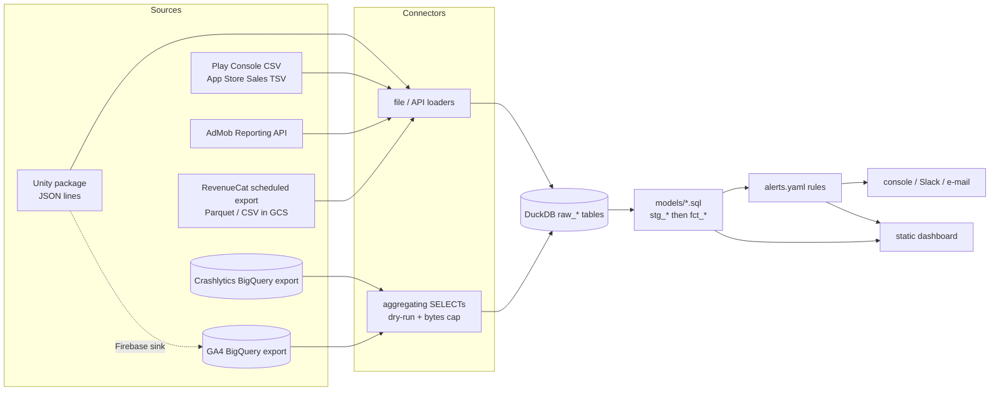

# studio-pulse

One data and monitoring system for a small mobile studio's app portfolio.
It pulls each app's analytics, crash, revenue, ad and store data into one
DuckDB warehouse, computes the same metrics the same way for every app, checks
alert rules, and writes a static dashboard with a portfolio overview and one
page per app. A small Unity package adds client performance telemetry (frame
time, memory, load times) in a schema the warehouse already understands.

**[Demo dashboard](docs/demo/index.html)** - built by `pulse demo` from
synthetic data for three fictional apps. Every number in it is generated.

## Why

A studio with several apps ends up with the numbers spread across the Firebase
console, BigQuery, RevenueCat, AdMob, Play Console and App Store Connect, each
with its own definitions (what is a "user", is revenue gross or net, are
refunds subtracted, which day does a crash belong to). New team members cannot
see how the apps compare, and nobody notices that D1 retention dropped after a
release until days later. studio-pulse puts the raw data in one place, defines
each metric once in SQL (documented in [docs/METRICS.md](docs/METRICS.md)),
and runs the same checks for every app.

## Architecture



- **Warehouse**: one DuckDB file. Connectors write `raw_*` tables; each load
  replaces its own (app, source[, window/file]) slice, so re-running never
  duplicates data.
- **Models**: plain `SELECT` files in [`models/`](models). A ~125-line runner
  (`src/studio_pulse/runner.py`) finds the dependencies between them by name,
  orders them topologically and materialises each with `CREATE OR REPLACE`.
  `pulse models` prints the graph.
- **Source-side aggregation**: the GA4 and Crashlytics queries aggregate inside
  BigQuery (DAU/WAU/MAU, install cohorts x day, level reach, crash counts). No
  user id leaves BigQuery; performance samples carry no identifier. The same
  SQL text is rendered for DuckDB, which is how the demo and the tests run it
  on GA4-export-shaped Parquet files.

## Quickstart

```bash
python3 -m venv .venv && source .venv/bin/activate
pip install -e .[dev]
pulse demo --out demo-site      # ~15 s: generate, ingest, model, alert, build
open demo-site/index.html
```

`pulse demo` writes GA4/Crashlytics-export-shaped Parquet, incremental
RevenueCat deliveries (with refunds and re-deliveries), an AdMob API response,
UTF-16 Play Console CSVs, App Store Sales reports and Unity JSON lines for three
fictional apps, then runs them through the real connectors. One app has a
scripted bad release in its last days; the demo should end with three alerts:

```
3 alert(s):
  [CRITICAL] quartz_merge     crash_free_users_low         2026-10-31  crash_free_users 98.79% is below 99.00%
  [WARNING ] quartz_merge     d1_retention_drop            2026-10-30  d1_retention 24.00% is down 31.7% vs the trailing 14-day mean 35.14% (limit 20%)
  [WARNING ] quartz_merge     low_tier_frame_time_high     2026-10-31  frame_time_p50_ms 24.7 ms is above 20.0 ms [device_tier=low]
```

The committed copy in [`docs/demo/`](docs/demo) is the same output
(`pulse demo --out docs/demo`) and can be served with GitHub Pages
(`.github/workflows/pages.yml`).

## Connecting real sources

Copy `pulse.example.yaml` to `pulse.local.yaml` (gitignored, like `local/`
and every `*.duckdb`) and list your apps and their sources. Nothing secret goes
in the file; values can reference environment variables (`${NAME}`).

| Source type | What it reads | Credentials |
|---|---|---|
| `ga4_bigquery` | `analytics_<property>.events_*` | Application Default Credentials (`gcloud auth application-default login`) |
| `crashlytics_bigquery` | `firebase_crashlytics.<bundle>_<PLATFORM>` | ADC |
| `revenuecat` | Transactions export files, `gs://...` or a local folder | ADC for GCS |
| `admob` | Reporting API `networkReport:generate` | ADC with `admob.readonly` scope, or `PULSE_ADMOB_ACCESS_TOKEN` |
| `play_console` | `installs_*_overview.csv`, `ratings_*_overview.csv` | files you copy from the Play Console bucket |
| `app_store` | Summary Sales reports (`S_D_*.txt[.gz]`) | files you download |
| `unity_jsonl` | `*.jsonl[.gz]` written by `JsonLinesSink` | - |
| `ga4_files`, `crashlytics_files` | export-shaped Parquet/JSON (tests, demo, offline copies) | - |

```bash
pulse ingest --dry-run          # BigQuery: dry-run every query, print bytes, load nothing
pulse run                       # ingest + models + alerts (notifications dry-run) + dashboard
pulse run --notify              # same, and actually send notifications
pulse ingest --app puzzle_game --source revenuecat
pulse run-models && pulse build-dashboard --out local/site
```

BigQuery safety: every query is checked to be a single `SELECT`, dry-run first,
refused if the estimate is above `max_bytes_billed` (default and maximum 2 GB),
then run with `maximum_bytes_billed` set so BigQuery itself enforces the cap.
Nothing is ever written to BigQuery. Bytes billed per load are stored in
`meta_loads` and shown on the dashboard's freshness table.

## Metrics

DAU/WAU/MAU, stickiness, sessions per user, new users vs store installs,
D1/D7/D14/D30 retention and the cohort matrix, IAP proceeds (RevenueCat, deduped
and FX-converted), ad revenue (AdMob), ARPDAU, payer conversion, the cumulative
ARPU (LTV) curve and cumulative payer rate by days since install, crash-free
users and sessions, frame time p50/p95 by device tier, share of frames over
33.3 ms, memory p95, cold start and scene load p50/p95, performance by app
version, and a level funnel with win rate and churn by level. Exact formulas
and caveats: **[docs/METRICS.md](docs/METRICS.md)**.

## Alerts

Rules live in [`alerts.yaml`](alerts.yaml):

```yaml
- name: d1_retention_drop
  metric: d1_retention          # by install cohort
  condition: drop_vs_baseline   # vs the mean of the previous baseline_days points
  baseline_days: 14
  threshold_pct: 20
  min_sample: 50                # ignore cohorts under 50 users

- name: crash_free_users_low
  metric: crash_free_users
  condition: below
  threshold: 0.99
  severity: critical

- name: low_tier_frame_time_high
  metric: frame_time_p50_ms
  where: {device_tier: low}
  condition: above
  threshold: 20
```

`pulse alerts --dry-run` prints them; with `PULSE_SLACK_WEBHOOK_URL` set they
go to Slack, with `PULSE_SMTP_HOST` and `PULSE_ALERT_EMAIL_TO` (optionally
`PULSE_SMTP_PORT`, `PULSE_SMTP_USER`, `PULSE_SMTP_PASSWORD`, `PULSE_SMTP_FROM`)
by e-mail. `--fail-on-alert` exits with status 3 for use in a scheduler.

## Unity package

[`unity/com.studio.pulse`](unity/com.studio.pulse) (UPM): `PerfSampler`
(per-frame `Time.unscaledDeltaTime` into a ring buffer, p50/p95, frames over
33.3 ms, memory via `Profiler`), `LoadTimer` (cold start and scene loads),
device tiers from `SystemInfo`, and `IPulseSink` implementations for JSON
lines / HTTP and Firebase Analytics (`#if PULSE_FIREBASE`). No per-frame
allocations. The event schema is in **[docs/EVENTS.md](docs/EVENTS.md)**.

```csharp
Pulse.Initialize(new PulseConfig(), new JsonLinesSink(JsonLinesSink.DefaultFilePath()));
// later, when the first screen is interactive:
Pulse.MarkInteractive();
```

The runtime was compile-checked with Unity 6's bundled Mono C# compiler against
the UnityEngine module assemblies, with and without `PULSE_FIREBASE` (the
Firebase types stubbed for that check). Its UnityEngine-free core was run under
Mono to produce `tests/fixtures/unity/csharp_sample.jsonl`, which the Python
tests parse and check against DuckDB's percentiles.

## Development

```bash
pip install -e .[dev]
ruff check .
pytest            # 70+ tests, a few seconds
```

Layout: `src/studio_pulse/` (config, warehouse, runner, connectors, alerts,
dashboard, demo, CLI), `models/` (SQL), `tests/`, `unity/`, `docs/`.

## Limitations

- Every ingest is a full refresh of the configured window (default 60 days);
  fine for small and mid-sized apps, wasteful for very large GA4 exports.
  Cost is bounded by the per-query bytes cap, not optimised away.
- Retention, WAU/MAU and LTV come from GA4 `user_pseudo_id` (app instances):
  reinstalls and multiple devices count as separate users, as in GA4.
- Crash-free rates divide Crashlytics counts by GA4 DAU/sessions; they are close
  to, but not the same as, the Firebase console's numbers (different ids and
  day boundaries).
- RevenueCat customers are matched to GA4 cohorts by day, not by user id.
- Frame time p50/p95 are medians of per-window percentiles, not exact
  population percentiles (no histograms in the schema yet).
- The AdMob connector and the GCS/BigQuery paths are tested with mocked
  clients; the demo uses a response in the API's format, not a live account.
- The Unity package was compile-checked and its pure-C# core executed under
  Mono, but it has not been profiled on devices as part of this repository.
- No scheduler is included; run `pulse run` from cron, a CI schedule or a
  Cloud Run job.

## License

MIT - see [LICENSE](LICENSE).
