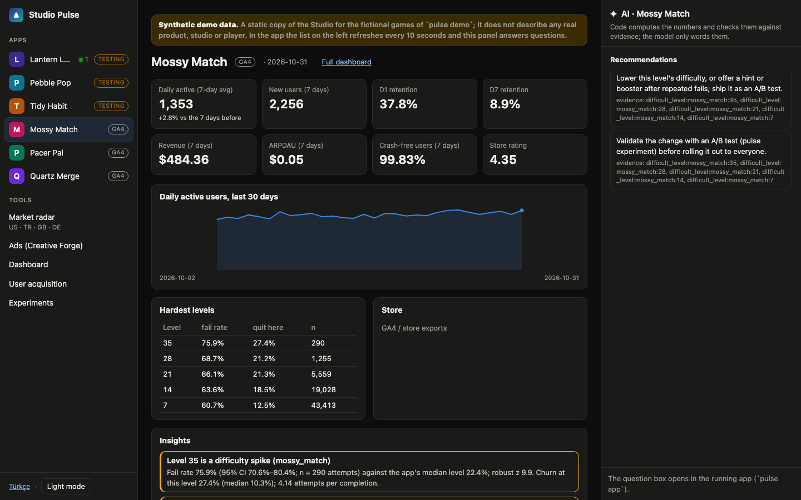
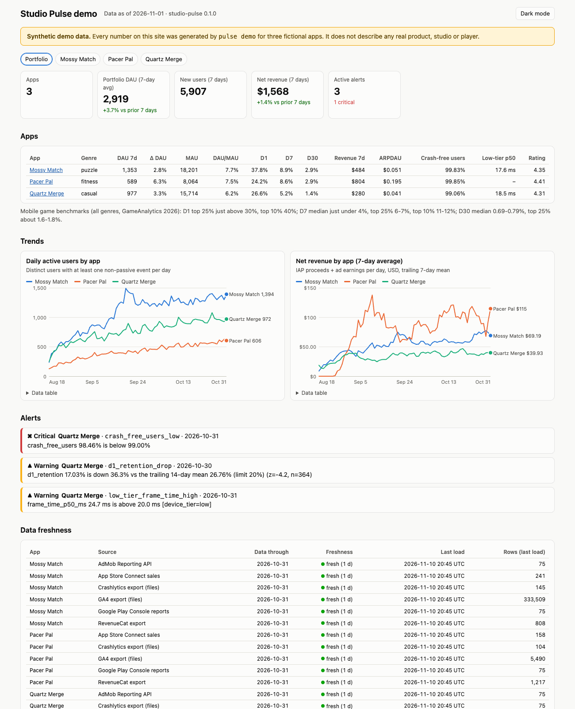
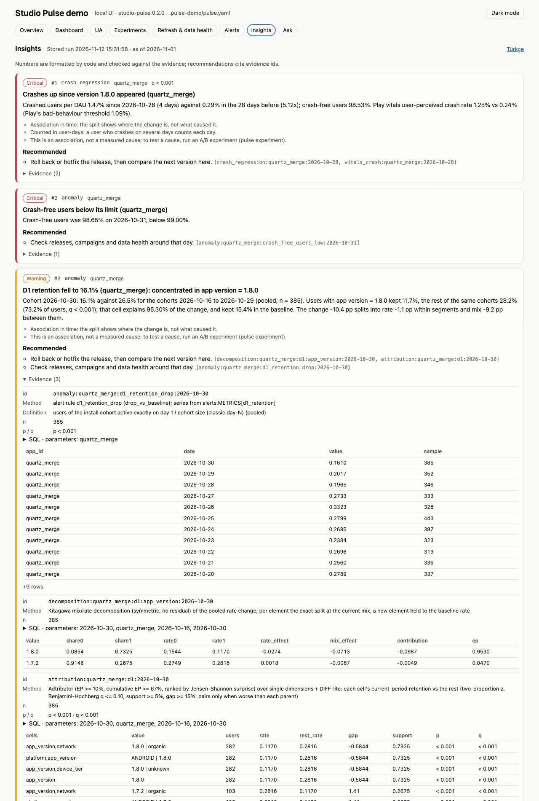
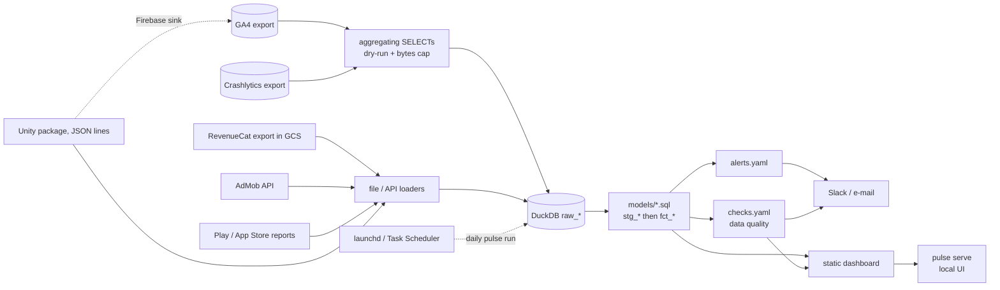

# studio-pulse

[](https://github.com/emirhann-akca/studio-pulse/actions/workflows/ci.yml)
[](pyproject.toml)
[](LICENSE)

Analytics and monitoring for a small mobile studio's app portfolio. GA4 /
Firebase, Crashlytics, RevenueCat, AdMob, Play Console and App Store reports,
ad-network spend (Meta, Google Ads, TikTok, CSV exports), store reviews and
Android vitals, plus Unity and Flutter telemetry packages, go into one DuckDB
warehouse; every app gets the same SQL metric definitions, the same alert
rules and the same static dashboard.

**Live demo: <https://emirhann-akca.github.io/studio-pulse/>** - synthetic data
for six fictional apps (three with GA4 and store exports, three sending through the
SDK collector), built by `pulse demo` (UA spend, an A/B test and store reviews
included). **The Studio, the app's one-window view:
<https://emirhann-akca.github.io/studio-pulse/studio/>** - a static copy (no
question box, no polling) with an invented market-radar day; Turkish under
`studio/tr/`.

[](https://emirhann-akca.github.io/studio-pulse/studio/)

[](https://emirhann-akca.github.io/studio-pulse/)

- **17 source connectors -> 56 SQL models + 2 statistics steps -> 59
  data-quality checks -> 11 alert rules -> static HTML.** `pulse demo`
  generates export-shaped files and recorded API responses and runs them
  through the real connectors, and plays three SDK games through a real
  collector over HTTP, in about 40 seconds.
- **UA economics**: Meta, Google Ads and TikTok spend through
  [dlt](https://github.com/dlt-hub/dlt)'s REST client, any other network from
  its CSV export; cohort ROAS D0/D7/D30, CPI, pooled ROAS curve and payback day
  per network and campaign, and a creative scorecard (IPM with a Wilson
  interval, CTR, CPI, modeled D7 ROAS, never ranked below a minimum of
  impressions) keyed by [creative-forge](https://github.com/emirhann-akca/creative-forge)'s
  creative ids parsed from ad names.
- **Experiments**: `pulse experiment` reads per-variant sums computed inside
  BigQuery (no user rows leave it) and reports a sample-ratio-mismatch check,
  z and Welch tests, CUPED and an always-valid (sequential) interval, ported
  from GrowthBook's MIT stats engine and checked against scipy, statsmodels and
  the NIST handbook. The SDKs assign the variations themselves
  (`Pulse.Experiment("key")` / `StudioPulse.experiment('key')`, GrowthBook's
  hash v2 of key + install id, identical in C#, Dart and Python against
  GrowthBook's own cases) and log one `experiment_exposure` per session.
- **Seasonality-aware alerts** (`forecast_band`: trend + weekday regression,
  or Nixtla statsforecast as an optional extra), **store reviews and Android
  vitals** (Play CSV + API, App Store Connect, Play Reporting API; rating by
  version, keyword topics in English and Turkish) and **predicted LTV v1**
  (curve fits with a time-based backtest, shown as a model with its error).
- **Runs on Windows 10/11 and macOS** (and Linux): a one-line installer, a
  daily refresh registered with launchd or Task Scheduler, and a local web UI.
  CI installs it with the real installers on all three and checks that the
  demo's model tables agree everywhere (text and integers exactly, floats to
  a relative 1e-9).
- **Industry-standard definitions**, one formula per metric in
  [docs/METRICS.md](docs/METRICS.md): classic day-N retention by install
  cohort, ARPDAU, payer conversion, cumulative ARPU (LTV) curve over complete
  cohorts only, crash-free users and sessions, frame time p50/p95 by device tier.
- **Retention against public benchmarks**: game pages place D1/D7/D30 in the
  GameAnalytics 2026 brackets (16,262 mobile games). The demo is calibrated to
  them: the good puzzle game sits at D1 38% / D7 9% / D30 3%.
- **Own SDK collector, live view and zero-setup registry** (`pulse collect`):
  one YAML event contract generates the Python, C#, Dart, JSON Schema and
  BigQuery definitions; the collector validates, dedupes, corrects device
  clocks, derives the country without storing the IP and fsyncs before it
  answers; a new game registers itself on its first event and moves new ->
  testing -> live (production installs plus a public store listing); `pulse
  serve` shows who is playing right now. Details in
  [docs/COLLECTOR.md](docs/COLLECTOR.md), [docs/CONTRACT.md](docs/CONTRACT.md),
  [docs/PRIVACY.md](docs/PRIVACY.md).
- **Own analytics SDKs for Unity games and Flutter apps** on the same contract:
  `Pulse.Init(key, url)` / `StudioPulse.init(...)`, then one line per level start,
  fail (with the death position), setting change, purchase or ad impression.
  Crash-safe disk queue, batching, gzip, backoff, the collector's status codes,
  UUIDv7 ids and a persisted sequence, 30-minute sessions, install store (Android
  installer, iOS AppTransaction), exit reasons, scrubbed errors, consent / opt-out
  / deletion / child mode, iOS privacy manifests; both SDKs write byte-identical
  batches for one scripted session ([docs/SDK_UNITY.md](docs/SDK_UNITY.md),
  [docs/SDK_FLUTTER.md](docs/SDK_FLUTTER.md)). Perf telemetry (Unity's
  `ProfilerRecorder` / FrameTimingManager counters, Flutter's
  `addTimingsCallback`) goes through the same queue.
- **Market radar** ([docs/RADAR.md](docs/RADAR.md)): a daily scan of Apple's
  game charts and iTunes Lookup plus Google Play details pages (robots.txt
  checked in code, 3 s apart, at most 200 a day) scores new games with a
  rule-based breakout score, tests weekly mechanic share shifts, classifies
  games from their store text with an LLM whose every claim must quote that
  text, and writes a Turkish and English digest in which every number is
  labelled observed, store-reported or estimate (a range). It runs inside
  `pulse run`, shows on a local `pulse serve` page and feeds
  [creative-forge](https://github.com/emirhann-akca/creative-forge)'s idea
  library through `market_trends.yaml`. Store data never goes to the public demo.
- **Shared LLM layer** (`studio_pulse.llm`): Gemini on Vertex AI, any
  OpenAI-compatible server (llama-server with a local LoRA), Anthropic Claude
  or a fake; content-hash cache, per-run budget cap, token/cost ledger, schema
  validation with one repair, retries, secrets kept out of logs.
- **Read-only, capped BigQuery access**: one `SELECT` per query, dry-run first,
  `maximum_bytes_billed` set; queries aggregate inside BigQuery, so no
  user-level row leaves it.
- **A grounded insight engine** (`pulse insights`, `pulse ask`, `/insights` and
  `/ask` in the local UI): deterministic statistics find and explain the
  changes, every number in a sentence is formatted by code and checked against
  its evidence, every answer must cover the filters and the period the question
  names (or it is refused with the reason), and a language model may only
  rephrase or propose a checked SELECT (see below and
  [docs/ANALYST.md](docs/ANALYST.md)).
- 837 Python tests, 45 Flutter tests and 40 C# SDK tests (`dotnet test`), ruff,
  dart analyze; CI on Windows, macOS and Linux x Python 3.11-3.13.

## Install

No admin rights and no Python needed: [uv](https://docs.astral.sh/uv/) (pinned)
installs Python 3.13 and studio-pulse for your user only.

```bash
# macOS / Linux
curl -LsSf https://raw.githubusercontent.com/emirhann-akca/studio-pulse/main/install.sh | sh
```

```powershell
# Windows 10/11 (PowerShell)
powershell -ExecutionPolicy ByPass -c "irm https://raw.githubusercontent.com/emirhann-akca/studio-pulse/main/install.ps1 | iex"
```

The installers look for the wheel of the `v0.2.0` GitHub release; no release
is published at the moment, so that download answers 404 and they install the
main-branch archive instead (uv builds it), printing which source they used.
Extras `gcp,ua` (BigQuery / Cloud Storage, ad-network APIs) are included;
`PULSE_EXTRAS=gcp,ua,forecast,stores` adds statsforecast and App Store Connect
key signing. They finish with `pulse doctor` and add an app launcher. From a
clone instead: `uv tool install .`, or pip as below. CI runs these two lines
verbatim on Windows PowerShell 5.1, macOS and Ubuntu, and forces the 404
fallback once.

**Studio** opens on **Today**, a morning brief from the last refresh: alerts,
sources that stopped sending, failing checks, every app's last 7 days against the
7 before (the tiles' metric definitions) and the market's day. It is the one-window view: every app on the left (configured apps and
every app the SDK collector has registered, with its live / testing / new status
and the installs active right now; a game whose SDK sends its first event shows
up under "new arrivals" before any refresh), the selected app in the middle
(numbers for the last 7, 30 or 90 days against the period before, DAU with the
previous period dashed, players now, store installs, hardest levels, stored
insights), and its AI panel on the right (the brain's recommendations with their
evidence ids, and a question box scoped to the app). Every number opens its own
page (`/studio/<app>/metric/<key>`) with the daily rows, both periods, the sample
size and the SQL that produced it; a rate whose sample is under its floor (for
example D1 retention from fewer than 50 installs) says "not enough data (n=…)"
instead of a percentage. Under the apps: the market radar inside the same window
(`/studio/market`: the day's verified summary, games rising on the charts with
their mechanic and where that tag came from, mechanics on today's charts, and
ideas for an ad test with the `mechanic_shown` creative-forge reads), Creative
Forge (when its app is running), live players, insights, questions, alerts and
data health. Every page shares the same sidebar, a ⌘K / Ctrl+K command palette,
light and dark themes and the studio-ui design system that Creative Forge also
uses; the interface is Turkish by default and English with `?lang=en` (the
choice is remembered).

**Settings** (`/settings`) connects store data without editing YAML: per app,
Google Play's reports bucket (read with the Google account already signed in for
the GA4 / BigQuery sources, so no new key) and the App Store (Apple ID, vendor
number and an App Store Connect API key with Sales access, stored as a file
*path*). It writes `pulse.settings.yaml` and `pulse.settings.env` (mode 600) next
to the config, which the loader merges; `pulse.yaml` is never rewritten and no
page shows a stored value. Each source has a "test connection" button; the daily
refresh can be set up from the same page, sending alerts to a Slack incoming
webhook saved there.

**Open it like an app.** The installers add **Studio Pulse** to the Start menu
and the Desktop (Windows), to `~/Applications` (macOS: Launchpad and Spotlight
find it) or to the applications menu (Linux); `PULSE_NO_SHORTCUT=1` skips that,
`pulse app --install-shortcut` / `--uninstall-shortcut` add or remove it later.
A double-click starts the local server on a free port and opens **Studio**
(`/studio`) in a window of its own (Edge, Chrome, Brave or Chromium in app mode: no tabs, no
address bar; the default browser otherwise). The first launch builds demo data
for six fictional apps behind a "getting ready" page; `pulse app --config
pulse.local.yaml` switches to your own data and the icon remembers it. A second
double-click opens a window on the running server instead of starting another,
and closing the last window stops the server (about 20 seconds later; the
window's pages tell it they are leaving). Output goes to
`<state dir>/logs/app.log`; `pulse app --check` starts, loads the pages and
stops, which is what CI runs from the installed launcher on all three systems.

```bash
pulse app                   # the same window from a terminal
pulse demo --open           # synthetic data for 3 apps -> dashboard in the browser
pulse serve --config .pulse-demo/pulse.yaml   # local UI on http://127.0.0.1:8765
```

From source (`py` instead of `python3` on Windows; no venv activation needed):

```bash
python3 -m venv .venv
.venv/bin/python -m pip install -e ".[dev]"     # Windows: .venv\Scripts\python -m pip install -e ".[dev]"
.venv/bin/pulse demo --open                     # Windows: .venv\Scripts\pulse demo --open
```

One demo app ships a bad release in its last four days. The run ends with:

```
Data quality: 58/58 checks passed, 0 error(s), 0 warning(s).
4 alert(s):
  [CRITICAL] quartz_merge  crash_free_users_low      2026-10-31  crash_free_users 98.65% is below 99.00%
  [WARNING ] quartz_merge  d1_retention_drop         2026-10-30  d1_retention 16.10% is down 39.1% vs the trailing 14-day pooled rate 26.46% (limit 20%) (z=-4.6, n=385)
  [WARNING ] quartz_merge  low_tier_frame_time_high  2026-10-31  frame_time_p50_ms 24.7 ms is above 20.0 ms [device_tier=low]
  [WARNING ] quartz_merge  play_crash_rate_bad       2026-10-31  vitals_crash_rate 1.15% is above 1.09%
Insights: 18 stored from 79 tested hypotheses.
```

The app's version table shows the regression is GPU-bound on low-tier phones
(GPU p95 close to the frame p95, CPU main thread well below it), Play vitals
put its crash rate over Play's bad-behaviour threshold, and version 1.8.0's
reviews average 1.7 stars. The UA page shows D7 ROAS of 15-68% across
networks and campaigns, one campaign paying back on day 50 and one creative
held back as "insufficient data"; the experiments page shows the demo's A/B
test, where CUPED corrects a lucky pre-period imbalance and the always-valid
interval says to keep running.

## Operating it

| Command | What it does |
|---|---|
| `pulse run` | one refresh: ingest, models, data-quality checks, alerts, dashboard. Holds a run lock (a second run exits 75, "locked") and writes a heartbeat |
| `pulse schedule install --at 09:30` | registers the daily refresh: a LaunchAgent on macOS (a missed run starts on wake), a Task Scheduler task on Windows (starts on battery, runs when missed, no console window) |
| `pulse schedule status` / `run-now --wait 600` / `remove` | registration, last result and last refresh; start it now; unregister |
| `pulse check` | the 59 checks in [`checks.yaml`](checks.yaml): keys, nulls, accepted values, ranges, per-source freshness, volume drop vs the trailing median, referential, reconciliations (DAU <= WAU <= MAU, retention in [0, 1], crash counts within their denominators, GA4 vs AdMob ad revenue, UA spend converted to USD, one spend row per network/day/ad, experiment sample ratio, SDK experiment buckets recomputed from key + install id). Error-level failures fail the run, are stored in the warehouse, shown on the dashboard and notified |
| `pulse experiment` | A/B test results from the warehouse (`--sql` prints the BigQuery aggregate query, `--input arms.csv` analyses totals from anywhere); exit 3 on a sample ratio mismatch |
| `pulse app` | the desktop app (opens `/studio`): the local UI in its own window, one server per user, stops when the last window closes; `--install-shortcut`, `--uninstall-shortcut`, `--check`, `--config` (remembered) |
| `pulse serve` | local UI on 127.0.0.1: dashboard, refresh health (heartbeat, recent runs, check results, source freshness, schedule state), alerts, and a run-now button. It opens the warehouse read-only per request and serves the last good snapshot while a refresh is writing |
| `pulse collect` | the SDK collector on 127.0.0.1:8787 (`setup-geoip`, `purge`); `pulse simulate` plays three fictional games against it, `pulse apps refresh` runs live detection ([docs/COLLECTOR.md](docs/COLLECTOR.md)) |
| `pulse radar run` / `show` | the market radar (also part of `pulse run` with `radar.enabled`); `--replay DIR` answers every request from recorded responses |
| `pulse doctor [--json]` | Python, time zones, DuckDB, config, writable folders, Google credentials (present or not, never their contents), schedule state |
| `pulse insights [--lang tr]` | the deterministic insight jobs (also run at the end of every refresh, stored in `meta_insights`) |
| `pulse ask "..." [--lang tr]` | a question in English or Turkish; the answer names its route and shows its SQL and rows |
| `pulse ask --eval [--set holdout\|holdout_b\|dev\|all] [--no-llm]` | held-out accuracy on the demo warehouse: right / partial / refused / confidently wrong with Wilson intervals; exit 1 on any confidently wrong answer |
| `pulse brain eval` | the router's golden, refusal and prompt-injection sets against the warehouse |

Details, file locations and Windows notes: [docs/OPERATIONS.md](docs/OPERATIONS.md).

## Insight engine

[](docs/img/insights.png)

Elite analytics products share one order of work - definitions, verified
queries, deterministic statistics, and only then a model that picks and
phrases - and `src/studio_pulse/brain/` follows it:

- **Metric catalog** ([`metrics.yaml`](src/studio_pulse/brain/metrics.yaml)):
  the machine-readable METRICS.md, with Turkish and English names and
  synonyms, unit, grain, dimensions and how rows combine (`pooled`, `sum`,
  `mean_of_daily`). Alert baselines read it too, so "the D1 baseline" is one
  number (pooled) in alerts, insights and answers.
- **Deterministic jobs**, each producing evidence (the SQL, rows, n, effect,
  interval, p and Benjamini-Hochberg q over everything scanned in the run): a
  data-trust gate first (stale or failed data gets a data card, not an
  explanation), alerts as the anomaly detector, mix vs rate decomposition,
  Adtributor and a DIFF-style scan of single and paired cohort cells,
  difficulty spikes (robust z + Wilson bound), the level funnel as a
  Kaplan-Meier curve, frame time by version x tier, crashes since a release,
  monetisation shifts, and user-property segments worded as associations.
- **A dimensional cohort pull** (`cohort_dims`): install cohorts aggregated
  inside BigQuery over GROUPING SETS of platform, country, version, first-touch
  source and device tier, no cell under 50 users. On the demo it turns "D1
  fell" into "D1 fell among users who installed 1.8.0 (11.7% vs 28.2% for the
  rest of the same cohorts)", which platform-only cohorts could not show.
- **Numbers by code, checked**: every number in a sentence is formatted by
  code (`%60,9` in Turkish, `60.9%` in English) and must match a value of the
  cited evidence; recommendations cite evidence ids; text written by players
  or ad networks is quoted as data.
- **Questions**: a verified-query library first, then the catalog with every
  filter of the question applied (network, platform, country, version, tier,
  store, level, period), then (only with a model configured) a model-written
  SELECT that passes a sqlglot AST guard and runs on the local warehouse in a
  read-only, locked DuckDB session with row and time limits - never on
  BigQuery - and otherwise a refusal that names what is missing.
- **Question-evidence consistency** (`brain/consistency.py`): verifying that
  a number equals its evidence is not enough - the evidence must answer the
  question. Every answer's SQL and rows are checked against the filters and
  period the question names; "CPI on Meta" for an app with no Meta spend is
  refused ("quartz_merge has no data for network = Meta"), never answered with
  the blend of its other networks.
- **Why questions** (`brain/drivers.py`): the change against the previous
  period, split by platform, country, app version, first-touch source, device
  tier, network or revenue type (Kitagawa mix/rate, Adtributor, DIFF-lite);
  the segment that moved it most and by how much, a release that appeared in
  the period, and the association-not-causation caveat.
- **Semantic layer** (`brain/semantic.py`): metric definitions, grain, valid
  filters with their stored values, windows, join paths and the METRICS.md
  formulas, generated from the catalog and METRICS.md; it is the model's view
  of the warehouse, and a test proves every METRICS.md metric is reachable by
  a question.
- **Held-out evaluation** (`pulse ask --eval`, [docs/ANALYST.md](docs/ANALYST.md)):
  questions written from METRICS.md and the schema, ground truth computed by
  SQL, a frozen held-out split never tuned on. On the held-out set (124
  questions, demo warehouse, 14 Nov 2026) the router went from 35% right / 36%
  confidently wrong to 83% / 3% on its first clean run (with
  gemini-3.5-flash-lite: 39% / 49% to 88% / 7%), and to 0 confidently wrong
  after the remaining error classes were fixed.

The language model is optional and narrow (`brain/llm.py`): tests and CI use
a deterministic fake; a real one comes from the shared layer (`studio_pulse.llm`)
and is off until the config asks for it:

```yaml
llm:                  # shared with the market radar
  provider: gemini    # or openai (llama-server with a local LoRA), anthropic
  model: gemini-3.5-flash-lite
brain:
  provider: shared    # none (default) | fake | shared | gemini | openai | anthropic
  budget_usd: 0.25    # per run, default 0.50
```

Questions can also reach the studio SDK's aggregates (level funnel with quits,
where players fail, settings turned off, purchases, ad revenue, crash-free
sessions); per-install tables and app error text stay out of reach.

## Architecture



Connectors write `raw_*` tables and replace only their own (app, source[,
file]) slice, so re-running never duplicates rows. Models are plain `SELECT`
files; `src/studio_pulse/runner.py` (~125 lines) infers their dependencies from
table names, orders them and materialises each with `CREATE OR REPLACE`
(`pulse models` prints the graph).

## Design decisions

- **DuckDB instead of a hosted warehouse.** After aggregation a studio's
  portfolio is megabytes, not terabytes. One file costs nothing, runs the same
  in CI, on a laptop and in a scheduled job, and the tests execute the real
  models. The models are standard SQL; moving them to BigQuery later is a
  dialect change, not a rewrite.
- **SQL files and a tiny runner instead of dbt.** Twenty models and one author:
  dbt's project, profiles and Jinja would be more code than the models. Each
  metric is one readable file and dependencies come from table names. I would
  switch to dbt once there are several authors or incremental models.
- **Aggregate inside BigQuery.** The GA4 and Crashlytics queries return daily
  and per-cohort aggregates, never `user_pseudo_id`s (a test checks every
  extraction output for ids). Personal data stays in the Firebase project, the
  result is tiny, and cost is bounded: every query is dry-run, refused above
  the cap and run with `maximum_bytes_billed`.
- **Dedupe the incremental RevenueCat export.** Each delivery re-sends changed
  transactions (refunds, unsubscribes), so summing raw rows counts a refunded
  purchase at full price and every re-delivery twice. I keep every version and
  pick the latest per (`store_transaction_id`, `renewal_number`), RevenueCat's
  key; `test_naive_sum_would_double_count` shows the difference.
- **Cap crash numerators at their denominators.** Crashlytics counts crashes,
  GA4 counts users and sessions; a device in a crash loop can crash more often
  than GA4 saw it start a session, and the rate went negative. The real-world
  run below is where this came from.
- **One calendar per app.** GA4 dates are in the property's time zone,
  Crashlytics and RevenueCat timestamps are UTC. Each app declares its
  `timezone`, and every UTC source is converted before it is cut into days.
- **Alerts must beat noise.** A 20% relative D1 drop is inside the noise for a
  50-user cohort, so the D1 rule also requires a 3-sigma binomial z-score.
- **Static HTML instead of a BI server.** Nothing to host or secure, pages diff
  in git and open from a file or GitHub Pages; charts are inline SVG with a
  data table each, no JavaScript libraries.
- **Synthetic demo, private data stays out.** The generator writes files in
  each source's real format, so the public demo exercises the same connectors
  as a live run. Real configs, warehouses and dashboards live in the gitignored
  `local/` folder.

## Real-world use

I have run studio-pulse read-only against the studio's live fitness app,
through its GA4 and Crashlytics BigQuery exports; every query was dry-run first
and capped by `maximum_bytes_billed`, and the results stay in `local/`. The run
surfaced a crash loop: on one Android install, Crashlytics recorded more fatal
crashes in a day than GA4 recorded sessions, which pushed crash-free sessions
below zero. That is why crash numerators are now capped at their denominators.

I designed the system - sources, metric definitions, architecture and checks -
and built it with AI coding agents working under my direction and review.

## Connecting real sources

Copy `pulse.example.yaml` to `pulse.local.yaml` (gitignored) and list your apps
and sources. No secrets go in the file; values can reference `${ENV_VARS}`.

| Source type | Reads | Credentials |
|---|---|---|
| `ga4_bigquery` | `analytics_<property>.events_*` | Application Default Credentials |
| `crashlytics_bigquery` | `firebase_crashlytics.<bundle>_<PLATFORM>` | ADC |
| `revenuecat` | scheduled Transactions export, `gs://...` or a folder | ADC for GCS |
| `admob` | Reporting API `networkReport:generate` | ADC (`admob.readonly`) or `PULSE_ADMOB_ACCESS_TOKEN` |
| `play_console`, `app_store` | installs/ratings CSVs, Summary Sales reports | files you copy |
| `unity_jsonl` | files written by the Unity or Flutter package's `JsonLinesSink` | - |
| `meta_ads` | Marketing API Insights, ad x country x day | `$PULSE_META_ACCESS_TOKEN` (system user, ads_read) |
| `google_ads` | `googleAds:search` GAQL, ad x day | ADC with the adwords scope or `$PULSE_GOOGLE_ADS_ACCESS_TOKEN`; Cloud-project access (developer tokens were retired on 9 Sep 2026); not verified against a live account |
| `tiktok_ads` | `report/integrated/get`, ad x country x day | `$PULSE_TIKTOK_ACCESS_TOKEN` |
| `ua_csv` | AppLovin, Unity Ads, Mintegral or any network's report export | files you copy |
| `play_reviews` | monthly `reviews/` CSVs from the Play Console bucket (+ the Play API's last 7 days) | ADC for GCS / androidpublisher |
| `app_store_reviews` | App Store Connect `customerReviews` | API key in `PULSE_ASC_*` env variables |
| `android_vitals` | Play Developer Reporting API crash and ANR rates | ADC (playdeveloperreporting) |

Ad-network and store APIs read credentials from the environment only (a
config that contains a token is refused, and every error message is redacted);
every API source can also replay recorded responses (`replay:`), which is how
the demo and the tests run. The UA and experiment setup is described in
[docs/METRICS.md](docs/METRICS.md) and [docs/OPERATIONS.md](docs/OPERATIONS.md).

```bash
pulse ingest --dry-run   # BigQuery: estimate bytes for every query, load nothing
pulse run                # refresh: ingest + models + alerts (notifications dry-run) + dashboard
pulse run --notify       # the same, and send alerts to Slack / e-mail
```

`pulse run` is the refresh command; `pulse schedule install` runs it daily on
your machine. Every run re-reads the lookback window (60 days by default),
which also picks up events GA4 adds to a day late.
[`.github/workflows/refresh.example.yml`](.github/workflows/refresh.example.yml)
is a disabled template for running it from a private repository with a service
account instead; this repository schedules nothing.

## Flutter SDK

[`flutter/studio_pulse`](flutter/studio_pulse): the analytics SDK for Flutter
apps ([docs/SDK_FLUTTER.md](docs/SDK_FLUTTER.md)), a pure-Dart core plus lifecycle
and error hooks and a small Kotlin / Swift channel, no third-party dependency. It
also carries the perf telemetry: the same
`pulse_perf` / `pulse_load` events from a Flutter app. Frame build and raster
times from `SchedulerBinding.addTimingsCallback` (p50 / p95 / max, frames over
33.3 ms and over the display's frame budget), cold start to the first
rasterized frame, resident memory, device tier; sinks for Firebase Analytics
(pass `FirebaseAnalytics.instance.logEvent`, no plugin dependency) and JSON
lines. The per-frame callback stores integers in preallocated typed lists.
`dart analyze` and `flutter test` run in CI; the JSON its tests write is parsed
by the Python connector (`tests/test_flutter_package.py`).

## Unity SDK

[`unity/com.studio.pulse`](unity/com.studio.pulse): the analytics SDK for Unity
games ([docs/SDK_UNITY.md](docs/SDK_UNITY.md)), a UnityEngine-free netstandard2.1
core (tested with `dotnet test` on three OSes and under Unity's Mono) plus a thin
adapter. Its perf telemetry: one `pulse_perf` event per
30 s window (frame time p50/p95/max, frames over 33.3 ms, CPU main-thread and
GPU p95, reserved / GC / OS-view memory), `pulse_load` events for cold start
and scene loads, device tiers from `SystemInfo`, and sinks for JSON lines /
HTTP and Firebase Analytics. Frame times come from FrameTimingManager's "CPU
Total Frame Time" through `ProfilerRecorder` and fall back to
`Time.unscaledDeltaTime`; memory comes from the release-player memory counters
and falls back to the `Profiler` API; each event records its source (`ft_src`,
`mem_src`). GPU timing is off on OpenGL ES by default because measuring it
there costs GPU time. The schema is in [docs/EVENTS.md](docs/EVENTS.md); a test
keeps the C# and Python constants in sync.

The runtime compiles with Unity 6.3's bundled C# compiler against the engine
assemblies with `-warnaserror`, with and without `PULSE_FIREBASE`; the IL of the
per-frame method contains no allocation, and the engine-free core runs under
Mono to produce the fixtures the Python tests parse.

## Limitations

- Every run is a full refresh of the lookback window: right for small and
  mid-sized apps, wasteful for very large GA4 exports (cost is bounded by the
  bytes cap, not optimised away).
- Users are GA4 app instances (`user_pseudo_id`): reinstalls and second devices
  count as new users, as in GA4. RevenueCat customers are matched to GA4
  cohorts by day, not by id.
- Crash-free rates divide Crashlytics counts by GA4 DAU and sessions, so they
  approximate rather than reproduce the Firebase console.
- Frame time p50/p95 per tier are medians of per-window percentiles, not
  population percentiles (the schema carries no histograms).
- The AdMob, GCS and BigQuery paths are tested with mocked clients. The Unity
  package is compile-checked and its core executed under Mono, but not
  profiled on devices in this repository.
- `pulse schedule` covers macOS and Windows; on Linux use cron or a systemd
  timer. The Windows task runs while you are logged in (a missed run starts at
  the next logon or wake).
- The ad-network, store-review and vitals connectors are tested only with
  recorded responses in the documented shapes; none has been run against a
  live account (Google Ads under its post-September-2026 access model
  included). CSV header aliases for AppLovin, Unity Ads and Mintegral come
  from public help pages, not from real exports.
- Without an MMP, ROAS per campaign is GA4 first-touch where GA4 sees the
  campaign (Google Ads) and otherwise a model (network installs x the
  cohort's average ARPU), which overstates cheap geos; every figure carries
  its basis. Creative D7 ROAS is always that model.
- pLTV v1 fits smooth curves; a subscription app's stepped revenue fits badly
  (the demo's fitness app backtests at about 35% error, shown on its page).
- The insight engine explains changes by association in time (a cohort
  split, a release date), never by experiment, and says so in every such
  sentence. The analyst is measured on the synthetic demo only; on held-out
  questions it still refuses some answerable ones and is occasionally wrong
  (numbers in [docs/ANALYST.md](docs/ANALYST.md)).

## Development

```bash
pip install -e ".[dev]"
ruff check . && ruff format --check .
python -X warn_default_encoding -m pytest -W error::EncodingWarning   # 738 tests (2 Windows-only, 1 needs the forecast extra, 1 opt-in GeoIP), ~80 s
pulse demo --out docs/demo  # regenerate the committed demo
```

The encoding flags make an implicit locale encoding an error on every OS, which
is how a Turkish-Windows (cp1254) bug shows up on a Mac. CI
([`ci.yml`](.github/workflows/ci.yml)) runs the tests on Windows, macOS and
Linux x Python 3.11-3.13, installs the built wheel with `install.sh` /
`install.ps1` and runs doctor, demo, checks and the UI in a folder with Turkish
characters, registers and fires a real launchd / Task Scheduler job, and
compares every model table across all jobs (equal hashes, or the same rows with
floats within a relative 1e-9: parallel sums add in a different order on each
machine). Tags `v*` build and
publish the release ([`release.yml`](.github/workflows/release.yml)).

Layout: `src/studio_pulse/` (config, warehouse, runner, connectors incl. `ua/`
and `reviews`, stats (experiments, forecast, pLTV), checks, alerts, runstate,
schedule, serve, doctor, dashboard, demo, CLI, brain), `models/` (SQL), `tests/`,
`unity/`, `flutter/`, `docs/`.

## License

MIT - see [LICENSE](LICENSE).
