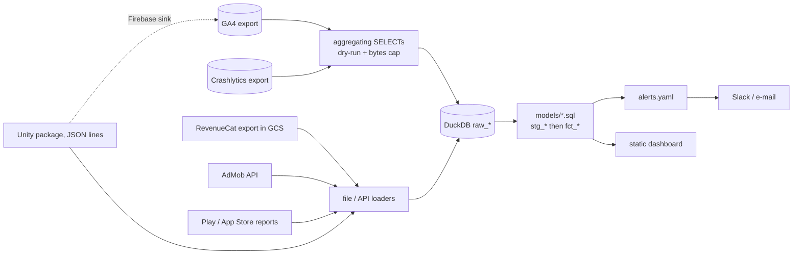

# studio-pulse

[](https://github.com/emirhann-akca/studio-pulse/actions/workflows/ci.yml)
[](pyproject.toml)
[](LICENSE)

Analytics and monitoring for a small mobile studio's app portfolio. GA4 /
Firebase, Crashlytics, RevenueCat, AdMob, Play Console and App Store reports,
plus a Unity telemetry package, go into one DuckDB warehouse; every app gets
the same SQL metric definitions, the same alert rules and the same static
dashboard.

**Live demo: <https://emirhann-akca.github.io/studio-pulse/>** - synthetic data
for three fictional apps, built by `pulse demo`.

[](https://emirhann-akca.github.io/studio-pulse/)

- **9 source connectors -> 20 SQL models -> 7 alert rules -> static HTML.**
  `pulse demo` generates export-shaped files and runs them through the real
  connectors in about 15 seconds.
- **Industry-standard definitions**, one formula per metric in
  [docs/METRICS.md](docs/METRICS.md): classic day-N retention by install
  cohort, ARPDAU, payer conversion, cumulative ARPU (LTV) curve over complete
  cohorts only, crash-free users and sessions, frame time p50/p95 by device tier.
- **Retention against public benchmarks**: game pages place D1/D7/D30 in the
  GameAnalytics 2026 brackets (16,262 mobile games). The demo is calibrated to
  them: the good puzzle game sits at D1 38% / D7 9% / D30 3%.
- **Unity package** on the runtime APIs Unity documents for release players
  (`ProfilerRecorder`, FrameTimingManager counters), zero per-frame
  allocations, and every event says which API produced its numbers.
- **Read-only, capped BigQuery access**: one `SELECT` per query, dry-run first,
  `maximum_bytes_billed` set; queries aggregate inside BigQuery, so no
  user-level row leaves it.
- 93 tests, ruff, CI on Python 3.11 and 3.13.

## Quickstart

```bash
python3 -m venv .venv && source .venv/bin/activate
pip install -e .[dev]
pulse demo --out demo-site && open demo-site/index.html
```

One demo app ships a bad release in its last four days. The run ends with:

```
3 alert(s):
  [CRITICAL] quartz_merge  crash_free_users_low      2026-10-31  crash_free_users 98.46% is below 99.00%
  [WARNING ] quartz_merge  d1_retention_drop         2026-10-30  d1_retention 17.03% is down 36.3% vs the trailing 14-day mean 26.76% (limit 20%) (z=-4.2, n=364)
  [WARNING ] quartz_merge  low_tier_frame_time_high  2026-10-31  frame_time_p50_ms 24.7 ms is above 20.0 ms [device_tier=low]
```

and the app's version table shows the regression is GPU-bound on low-tier
phones (GPU p95 close to the frame p95, CPU main thread well below it).

## Architecture



Connectors write `raw_*` tables and replace only their own (app, source[,
file]) slice, so re-running never duplicates rows. Models are plain `SELECT`
files; `src/studio_pulse/runner.py` (~125 lines) infers their dependencies from
table names, orders them and materialises each with `CREATE OR REPLACE`
(`pulse models` prints the graph).

## Design decisions

- **DuckDB instead of a hosted warehouse.** After aggregation a studio's
  portfolio is megabytes, not terabytes. One file costs nothing, runs the same
  in CI, on a laptop and in a scheduled job, and the tests execute the real
  models. The models are standard SQL; moving them to BigQuery later is a
  dialect change, not a rewrite.
- **SQL files and a tiny runner instead of dbt.** Twenty models and one author:
  dbt's project, profiles and Jinja would be more code than the models. Each
  metric is one readable file and dependencies come from table names. I would
  switch to dbt once there are several authors or incremental models.
- **Aggregate inside BigQuery.** The GA4 and Crashlytics queries return daily
  and per-cohort aggregates, never `user_pseudo_id`s (a test checks every
  extraction output for ids). Personal data stays in the Firebase project, the
  result is tiny, and cost is bounded: every query is dry-run, refused above
  the cap and run with `maximum_bytes_billed`.
- **Dedupe the incremental RevenueCat export.** Each delivery re-sends changed
  transactions (refunds, unsubscribes), so summing raw rows counts a refunded
  purchase at full price and every re-delivery twice. I keep every version and
  pick the latest per (`store_transaction_id`, `renewal_number`), RevenueCat's
  key; `test_naive_sum_would_double_count` shows the difference.
- **Cap crash numerators at their denominators.** Crashlytics counts crashes,
  GA4 counts users and sessions; a device in a crash loop can crash more often
  than GA4 saw it start a session, and the rate went negative. The real-world
  run below is where this came from.
- **One calendar per app.** GA4 dates are in the property's time zone,
  Crashlytics and RevenueCat timestamps are UTC. Each app declares its
  `timezone`, and every UTC source is converted before it is cut into days.
- **Alerts must beat noise.** A 20% relative D1 drop is inside the noise for a
  50-user cohort, so the D1 rule also requires a 3-sigma binomial z-score.
- **Static HTML instead of a BI server.** Nothing to host or secure, pages diff
  in git and open from a file or GitHub Pages; charts are inline SVG with a
  data table each, no JavaScript libraries.
- **Synthetic demo, private data stays out.** The generator writes files in
  each source's real format, so the public demo exercises the same connectors
  as a live run. Real configs, warehouses and dashboards live in the gitignored
  `local/` folder.

## Real-world use

I have run studio-pulse read-only against the studio's live fitness app,
through its GA4 and Crashlytics BigQuery exports; every query was dry-run first
and capped by `maximum_bytes_billed`, and the results stay in `local/`. The run
surfaced a crash loop: on one Android install, Crashlytics recorded more fatal
crashes in a day than GA4 recorded sessions, which pushed crash-free sessions
below zero. That is why crash numerators are now capped at their denominators.

I designed the system - sources, metric definitions, architecture and checks -
and built it with AI coding agents working under my direction and review.

## Connecting real sources

Copy `pulse.example.yaml` to `pulse.local.yaml` (gitignored) and list your apps
and sources. No secrets go in the file; values can reference `${ENV_VARS}`.

| Source type | Reads | Credentials |
|---|---|---|
| `ga4_bigquery` | `analytics_<property>.events_*` | Application Default Credentials |
| `crashlytics_bigquery` | `firebase_crashlytics.<bundle>_<PLATFORM>` | ADC |
| `revenuecat` | scheduled Transactions export, `gs://...` or a folder | ADC for GCS |
| `admob` | Reporting API `networkReport:generate` | ADC (`admob.readonly`) or `PULSE_ADMOB_ACCESS_TOKEN` |
| `play_console`, `app_store` | installs/ratings CSVs, Summary Sales reports | files you copy |
| `unity_jsonl` | files written by the Unity package's `JsonLinesSink` | - |

```bash
pulse ingest --dry-run   # BigQuery: estimate bytes for every query, load nothing
pulse run                # refresh: ingest + models + alerts (notifications dry-run) + dashboard
pulse run --notify       # the same, and send alerts to Slack / e-mail
```

`pulse run` is the refresh command. Every run re-reads the lookback window (60
days by default), which also picks up events GA4 adds to a day late.
[`.github/workflows/refresh.example.yml`](.github/workflows/refresh.example.yml)
is a disabled template for running it daily from a private repository with a
service account; this repository schedules nothing.

## Unity package

[`unity/com.studio.pulse`](unity/com.studio.pulse): one `pulse_perf` event per
30 s window (frame time p50/p95/max, frames over 33.3 ms, CPU main-thread and
GPU p95, reserved / GC / OS-view memory), `pulse_load` events for cold start
and scene loads, device tiers from `SystemInfo`, and sinks for JSON lines /
HTTP and Firebase Analytics. Frame times come from FrameTimingManager's "CPU
Total Frame Time" through `ProfilerRecorder` and fall back to
`Time.unscaledDeltaTime`; memory comes from the release-player memory counters
and falls back to the `Profiler` API; each event records its source (`ft_src`,
`mem_src`). GPU timing is off on OpenGL ES by default because measuring it
there costs GPU time. The schema is in [docs/EVENTS.md](docs/EVENTS.md); a test
keeps the C# and Python constants in sync.

The runtime compiles with Unity 6.3's bundled C# compiler against the engine
assemblies with `-warnaserror`, with and without `PULSE_FIREBASE`; the IL of the
per-frame method contains no allocation, and the engine-free core runs under
Mono to produce the fixtures the Python tests parse.

## Limitations

- Every run is a full refresh of the lookback window: right for small and
  mid-sized apps, wasteful for very large GA4 exports (cost is bounded by the
  bytes cap, not optimised away).
- Users are GA4 app instances (`user_pseudo_id`): reinstalls and second devices
  count as new users, as in GA4. RevenueCat customers are matched to GA4
  cohorts by day, not by id.
- Crash-free rates divide Crashlytics counts by GA4 DAU and sessions, so they
  approximate rather than reproduce the Firebase console.
- Frame time p50/p95 per tier are medians of per-window percentiles, not
  population percentiles (the schema carries no histograms).
- The AdMob, GCS and BigQuery paths are tested with mocked clients. The Unity
  package is compile-checked and its core executed under Mono, but not
  profiled on devices in this repository.

## Development

```bash
pip install -e .[dev]
ruff check . && ruff format --check .
pytest                      # 93 tests, ~7 s
pulse demo --out docs/demo  # regenerate the committed demo
```

Layout: `src/studio_pulse/` (config, warehouse, runner, connectors, alerts,
benchmarks, dashboard, demo, CLI), `models/` (SQL), `tests/`, `unity/`, `docs/`.

## License

MIT - see [LICENSE](LICENSE).
