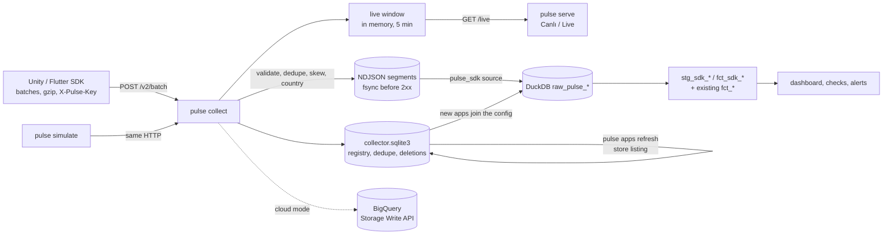
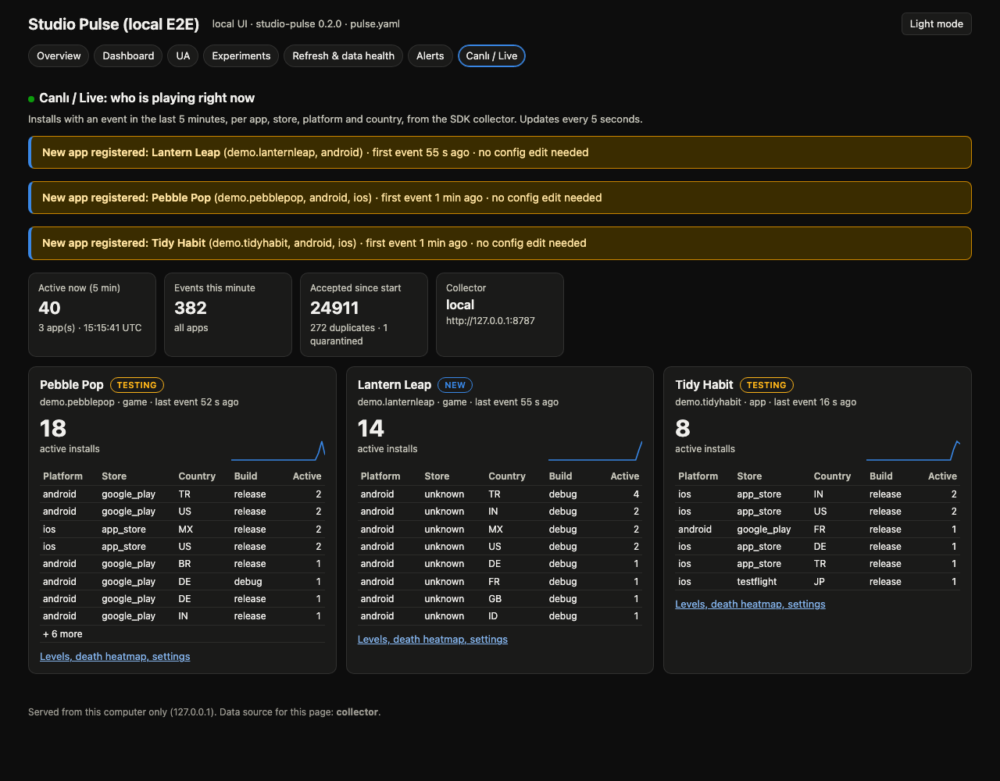

# SDK collector

`pulse collect` receives the events of the Studio Pulse SDK (Unity and
Flutter), checks them against [event contract v2](CONTRACT.md), stores them
durably, registers every new game on its first event and keeps a live view
of who is playing right now. `pulse run` loads what it stored into the
warehouse next to the GA4 apps; `pulse serve` shows the live view.



The design follows the research report (Nov 2026): a thin own SDK and
collector, no self-hosted analytics server (PostHog, Countly, Aptabase,
Snowplow ...), because studio-pulse already is the warehouse, metric layer,
checks and dashboard, and those servers bring ClickHouse/Kafka/MongoDB
operations or licence limits.

## Run it on a laptop (local mode)

```bash
pulse collect                                   # http://127.0.0.1:8787, store in ./local/collector
pulse simulate --backfill-days 14 --duration 180 --verify   # 3 fictional games against it
pulse run --config pulse.yaml                   # with a collector: block, see below
pulse serve --config pulse.yaml                 # Canlı / Live at http://127.0.0.1:8765/live
```

```yaml
# pulse.yaml (or pulse.local.yaml)
collector:
  data_dir: local/collector       # where pulse collect writes
  url: http://127.0.0.1:8787      # where pulse serve reads /live
  write_keys:                     # default when empty: sp_pub_local (laptop only)
    - key: ${PULSE_WRITE_KEY}
      apps: [com.example.pebblepop] # this key writes for these app_ids only (403 for others)
  read_key: ${PULSE_READ_KEY:-}   # optional; required by /live when set
  bundle_prefixes: []             # e.g. [com.grich.]: other apps are quarantined
  country_header:                 # e.g. CF-IPCountry behind Cloudflare
  live_min_installs: 20           # production installs in 24 h before "live"
  dashboard_min_status: new       # new | testing | live: which registry apps join the dashboard
apps:                             # may be empty: registry apps are added automatically
  - id: pebble_pop                # optional: name an SDK app yourself
    name: Pebble Pop
    genre: puzzle
    timezone: Europe/Istanbul
    sources:
      pulse_sdk: {bundle_ids: [com.example.pebblepop]}
```

Phones on the same Wi-Fi: `pulse collect --host 0.0.0.0 --key <your key>` and
point the SDK at `http://<laptop-ip>:8787`. With only the default key the
collector warns when it is reachable from the network.

**Bind every shipped key to its apps.** A bare key (`- <key>` in
`write_keys`, or no `=` in `PULSE_WRITE_KEYS` / `--key`) writes for any
`app_id`, so anyone who pulls it out of one build can create apps and send
events, purchases included, for another. A bound key is accepted only for its
`app_id`s: `{key: ..., apps: [...]}` in `pulse.yaml`, `key=app_id|app_id` in
`PULSE_WRITE_KEYS` (comma separated) or `--key`. A batch, JSON-lines request or
deletion for any other app answers `403 key_not_for_app` and nothing of it is
stored (the batch head goes to the quarantine). On a non-loopback address the
collector warns about every unbound key; `/healthz` reports `bound_keys`.

`pulse collect setup-geoip` installs DB-IP's free *IP to Country Lite*
database (CC BY 4.0, updated monthly): it reads the download page, takes the
`.mmdb.gz` link and the SHA1 DB-IP publishes for the uncompressed file
(checked against a real download on 12 Nov 2026), verifies it and writes
`geoip/dbip-country-lite.mmdb` with an `ATTRIBUTION.txt`. Without it the
country is `unknown` (or the trusted `country_header`). Needs the `geoip`
extra (`maxminddb`). Tests never download it.

## HTTP API

| Method and path | Body | Answer |
|---|---|---|
| `POST /v2/batch` | a v2 batch ([CONTRACT.md](CONTRACT.md)), optionally `Content-Encoding: gzip` | `200 {"accepted", "duplicates", "quarantined", "ignored", "rejected": [{"id", "reason"}], "skew_ms"}` |
| `POST /v1/ndjson` | contract v1 JSON lines (the Unity/Flutter perf packages' `JsonLinesSink`) | `200 {"accepted", "duplicates", "quarantined"}`; lines are upgraded to v2 rows with `schema = "1"` |
| `POST /v2/delete` | `{"install_id", "app_id"?, "reason"?}` | `202`: events of that install are refused from now on, stored rows go with the next run; rate limited per IP like ingest; a bound key needs its own `app_id` |
| `GET /live` | - | active installs per app in the last 5 minutes, breakdown, events per minute, registry status, new apps |
| `GET /healthz` | - | mode, counters, contract version (no keys, no data) |

The write key travels as `X-Pulse-Key` (or `Authorization: Bearer`). It is a
public, write-only key compiled into the game, like Aptabase's App-Key or a
PostHog project key: it gates spam and allows rotation (two keys accepted
during a rotation; every row records `key_id`, a hash prefix), it is not a
secret. `/live` needs the read key when one is set.

| Status | When | What the SDK does |
|---|---|---|
| 200 | every event was stored, quarantined (with a reason) or is a repeat | delete the batch |
| 400 | not JSON, broken gzip, invalid envelope (the batch head is quarantined too) | drop the batch, count it |
| 401 | unknown write key | stop sending until the next launch |
| 403 | `key_not_for_app`: the key is bound to other `app_id`s | stop sending until the next launch; the queue stays |
| 413 | more than 500 events, more than 1 MiB uncompressed or inflated | halve the batch |
| 415 | `Content-Encoding` other than gzip | (SDK bug) |
| 429 | rate limit (token buckets per salted IP hash and per install) | back off, retry |
| 503 | the durable write failed | back off, retry (a retry is deduped) |

## What happens to a batch

1. **Size and decoding.** The body is read with a hard cap of 1 MiB; gzip is
   inflated with the same cap (a gzip bomb answers 413).
2. **Envelope.** `v`, `schema`, `sent_at`, `ctx` with the required fields
   (`app_id`, `platform`, `app_version`, `install_id` as a UUID, `sdk`); a
   context string that looks like an e-mail address refuses the batch.
3. **Consent, deletions, allowlist.** `ctx.consent = denied` stores nothing.
   An install with a deletion request stores nothing. With `bundle_prefixes`,
   other apps go to the quarantine and get no registry row.
4. **Each event** is checked against the contract (names, reserved names,
   types, enums, ranges, required parameters, at most 25 parameters, 8 KB per
   event, no e-mail-like strings). A failing event is written to the
   quarantine with its reason code; the rest of the batch is stored.
   `ctx.child = true` drops `uid` and free-text parameters.
5. **Clock.** `ts = received_at - (sent_at - ts_client)` (Segment's
   formula), so a device clock that is hours off still lands on the right
   time; the raw device time is kept. More than 1 h in the future after
   correction, or before 2020: quarantined. Older than 30 days: stored and
   flagged `late`.
6. **Dedupe.** Within the batch, then against the store: an event id or an
   `(install_id, seq)` seen in the last 7 days is a repeat. The warehouse
   dedupes again (`stg_pulse_events`), so a crash between the write and the
   dedupe index never doubles a metric.
7. **Durable write, then the answer.** Local mode appends the batch to
   `events/dt=YYYY-MM-DD/HH-<pid>.ndjson` (UTC hour of receipt) with one write,
   flushes and fsyncs (and fsyncs new directories on POSIX) before answering
   2xx. Cloud mode appends to BigQuery and waits for its acknowledgement.
8. **Registry and live window.** The first event of an unknown
   `(app_id, platform)` inserts exactly one registry row (an `INSERT OR
   IGNORE` on the primary key; tested with 50 concurrent first batches over
   HTTP and 50 racing SQLite connections). Release builds from a production
   store are remembered per install for live detection. The live window
   learns the install's newest event time.
9. **Country** comes from the trusted header or the GeoIP database and the
   IP address is then forgotten: it is never written anywhere (a test greps
   every stored byte for it). Rate limiting uses a salted hash of it, in
   memory.

Local storage: `events/` and `quarantine/` NDJSON segments plus
`collector.sqlite3` (WAL) for the registry, the dedupe index, production
installs and deletion requests. SQLite because the collector, `pulse apps
refresh` and `pulse run` use that state at the same time; a DuckDB file allows
one writing process only. The events themselves are plain NDJSON so any tool
can read them.

## New games register themselves; live detection

| Status | Meaning |
|---|---|
| `new` | first event seen (e.g. a developer's debug build) |
| `testing` | a release build sent data, or an install from TestFlight / a sideload |
| `live` | `pulse apps refresh`: release builds from a production store reached `live_min_installs` distinct installs in 24 h **and** the public store listing exists |

The store check: iTunes Lookup `https://itunes.apple.com/lookup?bundleId=<id>`
returns one result for a published app and zero otherwise (the `bundleId`
parameter is undocumented: a signal, not a gate); the Play details page
`https://play.google.com/store/apps/details?id=<package>` answers 200 or 404
(details pages are allowed by Play's robots.txt, search pages are not). At
most one request every 3 s, a result is reused for 24 h, network trouble
counts as "unknown", never "not listed", and a status never goes down by
itself. Play's internal and closed tracks probably report the Play installer
too, which is why installs alone never make a game live. The recorded
responses in `tests/fixtures/stores/` come from four requests made on
12 Nov 2026.

`pulse run` (through `load_config`) adds every registry app that no
`pulse_sdk.bundle_ids` claims to the app list: id from the bundle id
(`com.example.game` -> `com_example_game`), the name the SDK sent
(`ctx.app_name`), genre `game` for Unity builds or games that send level
events, time zone UTC. It then has a dashboard page, checks and alerts like
any configured app; `dashboard_min_status: testing` hides developer-only
builds, `auto_apps: false` turns it off.

## In the warehouse

The `pulse_sdk` source reloads the lookback window from the segments into
`raw_pulse_events` (dates in the app's time zone, deleted installs left out),
`raw_pulse_quarantine` (counts per day and reason) and
`raw_pulse_app_registry`. The same run removes deleted installs from segments
older than two hours, deletes days past the 13-month retention and marks a
deletion request done once no segment holds that install (`pulse collect
purge` does the same on demand).

| Model | What |
|---|---|
| `stg_pulse_events` | one row per event id and per (install_id, seq); `is_prod` = release builds not from the editor or a simulator |
| `stg_sdk_sessions` | sessions by `sid`, split again at 30 minutes without events; length from foreground time; crashed (next-launch `pulse_exit` or a fatal error) |
| `stg_sdk_installs` | per install: cohort day (its `pulse_install`), store, country, highest level, churned (7 days quiet) |
| `stg_sdk_active_users`, `stg_sdk_cohort_days` | the GA4 shapes, unioned into `stg_active_users` / `stg_cohort_days`: DAU/WAU/MAU, new users, sessions, engagement, crash-free, IAP and ad revenue, retention and LTV work for SDK apps unchanged (a GA4 row wins during a dual-write migration) |
| `stg_level_daily`, `stg_level_max` | feed the existing `fct_level_funnel` |
| `fct_sdk_level_funnel` | starts, completes, fails, quits, fail rate, attempts to the first win, inferred quits (a session that ends on a level start), players reached, churned here (the quit level) |
| `fct_sdk_fail_heatmap` | `level_fail` / `level_quit` positions per level on a 10 x 10 grid (`pos_space` norm or world) |
| `fct_sdk_settings`, `fct_sdk_settings_when` | share of players who turned music / sfx / haptics ... off, and in which session |
| `fct_sdk_experiments` | installs per experiment and variation from `experiment_exposure` (-1 = outside the coverage), the split, installs that reported two variations and installs whose bucket differs from the one recomputed in SQL from the key and install id (check `sdk_experiment_assignment`) |
| `stg_sdk_purchases`, `fct_sdk_purchases` | purchases per transaction id, USD with the config's `fx_rates`; sandbox and restores carry no revenue |
| `stg_sdk_ad_impressions`, `fct_sdk_ad_revenue_daily` | impression-level ad revenue |
| `fct_sdk_errors`, `fct_sdk_errors_daily` | errors per fingerprint, errors per session, crash-free sessions |
| `stg_perf_windows`, `stg_load_times` | now also read `pulse_perf` / `pulse_load` from the SDK |
| `fct_sdk_data_quality` | duplicate rate, sequence loss, clock skew, late share, quarantine rate |
| `fct_sdk_apps` | the registry next to what the warehouse holds |

Checks (`checks.yaml`): `sdk_seq_loss_below_2pct` (error, judged from 2,000 expected events), duplicates < 1%,
clock-skewed events < 10%, quarantine < 1% (warnings), unique event ids and
funnel rows, accepted install stores. Metric definitions: [METRICS.md](METRICS.md).

## Canlı / Live

`pulse serve` has a **Canlı / Live** page: active installs in the last five
minutes per app with the store x platform x country x build breakdown, an
events-per-minute sparkline, new / testing / live badges, and a banner when a
game registers itself. It polls every 5 s through htmx (vendored, no Node
build). The serve process asks the collector itself, so the read key never
reaches the browser. Each app links to its levels page: fail rate by level,
the funnel table, the death heatmap of the hardest levels and the settings
players turn off, from the warehouse models.



## Cloud Run (cloud mode)

The same code with `PULSE_COLLECTOR_MODE=bigquery` writes through the
BigQuery Storage Write API (default stream, Arrow record batches, first
2 TiB per month free) and MERGEs the registry. One instance
(`--max-instances=1`) keeps one live view; a restart refills it within five
minutes. Plan, deploy scripts (print-only unless `--apply`), environment and
the cost table: [deploy/cloudrun/README.md](../deploy/cloudrun/README.md).
Roughly $0 a month at 1 M events and $2 now to $12 after a year at 100 M
events, mostly BigQuery storage.

The warehouse reads the SDK events from those tables, not from a local
folder, once the collector block names them:

```yaml
collector:
  url: https://pulse-collector-xxxx.run.app   # pulse serve / Studio read /live here
  read_key: ${PULSE_READ_KEY}
  bigquery: {project: my-project, dataset: pulse_raw}   # pulse_sdk sources load from here
```

Each run selects the lookback window from `events` and `quarantine` (the
`received_at` bound prunes the daily partitions; timestamps come back as epoch
milliseconds, the local store's unit), leaves out installs with a
`deletion_requests` row, and reads the registry from `app_registry`; dry-run
first and capped by `max_bytes_billed`, like every BigQuery query here. A test
loads the same simulated sessions both ways (local NDJSON and BigQuery-shaped
tables) and requires identical `raw_pulse_events` and registry rows. Apps the
config does not list are not added from the cloud registry yet: name them under
`apps:` with their `pulse_sdk.bundle_ids`.

## Security

- Body caps: 1 MiB raw and inflated, 500 events, 8 KB per event; JSON parsed
  only after the cap.
- Keys: write keys public and rotatable, read key private (server side only),
  no key in a URL or a log.
- Rate limits per salted IP hash and per install (token buckets, in memory);
  127.0.0.1 is not limited by default.
- Time sanity, quarantine with reasons, data-quality checks on loss,
  duplicates, skew and quarantine rate.
- The collector binds 127.0.0.1 unless told otherwise and warns when it is
  exposed with the default key.

## Simulator

`pulse simulate` plays three fictional games (Pebble Pop, a puzzle game with
difficulty spikes at levels 12, 25 and 40; Tidy Habit, a habit app; Lantern
Leap, a runner that starts mid-run on developer builds) with the SDK's
behaviour: UUIDv7 ids, persisted sequence numbers, 30-minute sessions,
foreground time, flush at 20 events / 30 s / background, gzip over 1 KB,
install stores, platforms, countries (as `CF-IPCountry`), device tiers, wrong
device clocks, 0.4% lost batches, 1% re-sent batches and 0.1% invalid events.
`--verify` compares the collector's `/live` with what it sent and exits 1 on
a mismatch. `pulse demo` runs it against an in-process collector whose clock
follows the simulation, so the demo is the same on every OS.

## Verified and not verified

- Tested on Windows, macOS and Linux in CI: every HTTP path, gzip, limits,
  dedupe, skew, quarantine, consent, deletion and purge, the registry under
  concurrency, the live window, the models with hand-computed numbers, the
  simulator against a real local server, and a collector + simulator + `/live`
  smoke job on windows-latest and macos-latest.
- Cloud mode is tested with fake BigQuery clients only; nothing has been
  deployed from this repository.
- The store checks use recorded responses; the Apple `bundleId` lookup is
  undocumented.
- The SDKs (Unity: [SDK_UNITY.md](SDK_UNITY.md), Flutter: [SDK_FLUTTER.md](SDK_FLUTTER.md))
  post to a real `pulse collect` in CI and in their own E2E drivers; both write
  `contract/golden/sdk_conformance.ndjson` byte for byte, and
  `tests/test_sdk_conformance.py` stores that file through the collector.
